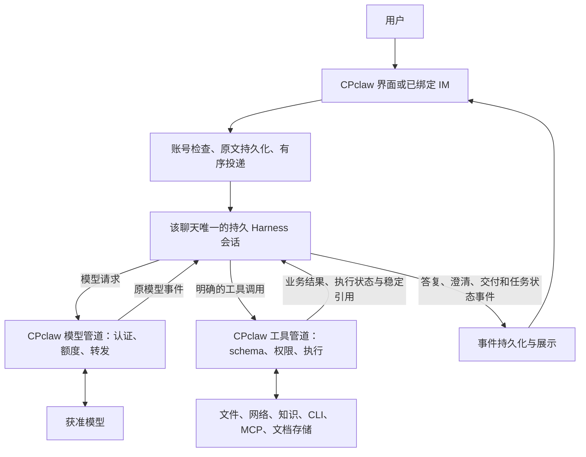

# Harness 统一运行与 CPclaw 信息管道

> 发行更新：0.0.42 已替换本机应用并部署配套云端管道；合成真实模型聊天/文档验收通过。完整开放业务质量仍须另验，见 [发布记录](../verification/unified-harness/发布记录.md)。

日期：2026-11-05。状态：用户已确认；桌面及配套平台源码已迁移并通过受控验证，安装包及云端未发布。

决策依据：[ADR-006](../decisions/ADR-006-Harness与信息管道边界.md)。主方案对应工作区 `harness/企业级智能体平台技术方案.md` V1.9。本文工具名是 CPclaw 注册到 Harness 的宿主契约；SDK 会话与事件通过适配器连接，不要求 SDK 内置同名工具。

## 1. 基本原则与范围

**CPclaw 不参与任务内容的信息处理，只做好信息管道。DeepSeek Harness 是所有用户任务唯一的信息处理与推理运行时。**

普通问答、澄清、规划、联网研究、文件处理、应用操作、文档交付、Wiki 编制、经验提炼和诊断解释均服从同一边界。无需先由另一个模型判断是否需要 Harness，不按任务关键词选择另一条模型链路。

这里的“信息处理”包括语义理解、选择相关内容、推断主题、规划、归纳、摘要、压缩、重排证据、判断资料充分性、组织答案和判断任务是否完成。CPclaw 不自行实现这些步骤，也不绕过 Harness 直接调用 LLM 完成它们。

传输编码、文件字节读取、存储、哈希、协议/类型校验、ACL、额度、幂等、确定性文件差异与安全渲染属于管道和执行保障。它们不能被扩展为内容理解或任务决策。受控工具可按 Harness 的明确调用执行解析、查询等操作；工具输出作为数据返回 Harness，不在宿主继续生成摘要、选取证据或决定下一步。

## 2. 职责归属

| 能力 | Harness | CPclaw 桌面与云端 |
|---|---|---|
| 用户输入 | 理解原文、追问和指代；决定澄清或执行 | 原文及附件引用持久化、排序、投递和接收回执 |
| 会话与上下文 | 维护对话上下文、历史使用及压缩；识别继续或新任务 | 账号/聊天/会话映射、事件镜像、传输游标和恢复连接 |
| 项目、知识库、Wiki、Skill | 决定何时读取、检索、引用及如何使用内容 | 提供明确关联的资源标识、版本、可调用目录及受控访问 |
| 工具 | 选择工具、形成参数、安排步骤、解释回执 | schema 校验、权限检查、执行调用、返回原始业务结果与执行元数据 |
| 最终答案与文档 | 撰写、分段提交、修改、判断内容完成 | 展示消息，按调用暂存/提交文件；检查路径、版本、哈希及持久化结果 |
| 中断与错误 | 根据错误和既有回执决定后续语义动作 | 原因、执行状态和未知结果如实反馈；取消、熔断与连接恢复 |
| 预算 | 在剩余额度内安排任务；说明未完成项 | 执行明确的调用次数、时长、费用硬限制；拒绝超限调用 |
| Wiki、学习、诊断 | 编制、提炼、解释与提出修复建议 | 提供获准材料、结构化健康检查、版本、审核和发布状态 |
| 模型代理 | 构造与管理模型对话 | 鉴权、获准模型映射、协议适配、流转发、计量；不注入业务推理或改写内容 |

权限与授权取决于可信宿主和用户设置，不能由模型自称已获批。可共享资源不意味着可共享聊天历史。数据出机、学习授权、云端发布和敏感操作继续执行既有控制，不因统一运行而扩大。

## 3. 唯一主链路

用户内容和工具结果的业务解释都在 Harness 中。CPclaw 不存在“聊天模型先分流”“采集够了切回文档模型”或“异常时备用模型补答”的业务链路。SDK 子进程可以按运行策略启动/关闭，逻辑会话的持久身份和历史必须连续。

## 4. 会话、项目与输入契约

一个 CPclaw 聊天绑定一个持久 Harness 会话，普通聊天和工具任务均使用它。建立聊天时持久化唯一映射；若 SDK 只能延迟创建物理会话，应在首条消息投递时完成创建并确认，不能另建普通聊天上下文。映射包含账号与设备运行域，不能只依赖客户端提交的会话编号授权。

不同聊天的消息、内核上下文、收件箱、工具执行历史独立。相同项目目录、知识库、Wiki 和资源可按授权共用。资源写入可能被其他聊天后续读到，但不会自动注入另一会话。项目绑定变化不自动清除已经进入内核的历史，也不授予新权限。

每次输入的管道记录至少关联：账号、聊天、Harness 会话、稳定输入标识、顺序/关联标识、用户原文、附件引用、显式资源绑定与当前权限版本。附件和资源保留版本/哈希及稳定访问入口。大小超限时明确拒绝或使用附件引用，不静默截断正文或筛选“成功历史”重建另一份上下文。

“继续”“换成网上检索”等文本照常投递。CPclaw 不用短语表把它们重写为重试，也不拼接上一任务主题。用户显式点击“恢复连接/重试投递”是传输命令，应关联原输入，不能伪装成一条新的用户指令。两种入口由不同协议动作表达。

## 5. 工具与资源契约

- 根据身份、ACL、显式启用资源和连接状态提供工具目录；不按用户话题关键词裁剪或自动挑选相关工具。
- 文件读取、终端、网络、知识查询、应用调用、文档交付使用明确的类型及参数 schema。CLI 和 MCP 可有各自协议适配，不能把不同动作都压入无结构的 JSON 字符串并仅靠长提示区分。
- 知识工具执行 Harness 给出的查询、资源范围、分页或过滤参数；后端执行索引查询与权限过滤，返回命中项、版本及定位。相关性选择、证据比较、总结和引用决策在 Harness 内，不再由聊天宿主用用户输入预先摘选片段塞入 prompt。
- 大工具结果提供稳定完整结果引用、分页/偏移及明确的字节长度；按协议返回一页或块，不靠语义摘录压缩。Harness 决定继续读哪部分及是否已足够。
- 每次工具调用记录调用标识、参数版本/哈希、授权版本、执行状态和结果引用；执行回执与展示事件能相互关联。账号凭证不进入业务 prompt；受保护字段遵循传输权限及确定性遮蔽规则，不以脱敏名义改写业务事实。

自动批准只决定是否询问；强制确认与资源 ACL 仍由宿主执行。框架格式检查与内容验收分开：路径有效、文件已写入不能证明内容正确。

## 6. 文档交付与任务状态

文档交付是 Harness 的受控工具能力。内核选择目标、撰写正文、拆分段落、提交分段和完成标记；CPclaw 按明确的文档版本、段序、预期哈希和提交标记暂存或落盘，并返回可核验的成果引用。若工具失败，由同一会话收到失败并处理。

不再把内核答复截成独立文档模型的输入，不自动添加收尾指令，不合成“资料收集结束”的助手回答。模型长度上限等错误及已接收事件保留在原运行链路；如何续写由内核及其受验证的恢复机制处理，不自动切换模型或改变思考模式。

两类状态分开记录：

| 状态来源 | 能证明什么 |
|---|---|
| CPclaw 的 queued/accepted/running/interrupted/cancelled/failed 等运行状态 | 投递、进程、执行、取消和故障事实，不代表业务目标完成 |
| Harness 的答复、待用户输入及任务完成声明 | 内容与任务进度判断；呈现时关联其运行和工具证据 |
| 成果存储的暂存/提交/失败回执 | 指定版本是否实际落盘，不证明内容正确或全部任务完成 |

没有经过验证的 SDK 对应事件时，先定义适配与兼容测试，不由“模型 EOF”“工具全部返回 0”推导业务成功。不把中断、未知结果或部分文档显示为任务完成。

## 7. 取消、恢复、预算与日志

取消沿同一运行标识传入内核和工具。进程退出不代表外部副作用回滚；未知结果保留 unknown，不能自动重复提交写操作。

输入重投先核对稳定输入标识和内核接收回执，再决定恢复订阅或补投；不能因为没看到最终答复就再次入队。工具回执去重基于同一次稳定调用及幂等标识，参数一致性用于校验；相同参数的新调用不自动复用旧结果，避免把有意重新读取或重复业务动作当成网络重放。具体 SDK 恢复/幂等能力先验证，能力不足时保留明确的待核实状态。

HTTP 有限重试只适用于确认未受理或具备已验证幂等保证的请求；200 后的断流、受理状态不明、已执行工具不自动整轮重跑。不能把模型是否“可重试”当作副作用操作的授权。

硬预算基于显式配置和计量，不以“已读六份文件”“关键词命中架构”“字数够了”判定任务应收尾。预算耗尽返回结构化原因，由内核在可用恢复路径中说明；没有剩余额度时直接展示失败事实，不能合成答案宣称内核已经完成。

日志记录输入/运行/会话/模型调用/工具调用/成果版本的关联、授权版本、阶段、错误、结束原因、用量、长度与回执。默认不存业务正文、凭证或推理原文。CPclaw 可直接呈现结构化错误及恢复状态；需要解释、归因或修复方案时交给 Harness，并保持实际诊断证据与推断可区分。

## 8. Wiki、学习与云端范围

项目 Wiki 压缩、个人/组织知识编制、经验和 Skill 提炼、AI 诊断都属于语义作业，统一经 Harness，不保留独立宿主 LLM 提炼器。CPclaw 负责用户触发或明确授权计划的机械投递、材料授权、候选存储、审核、版本与分发；人工审核不受此边界取代。

这不新增云端员工任务托管或云端 Harness 集群。首期员工任务仍依赖在线 PC。旧设计中的云端独立 LLM 编制/优化路径退出目标设计；若未来需要云端语义资源作业，须另行明确其 Harness 执行域、服务身份、授权材料与预算。仅存储、索引查询、审核和发布资源不会自动启动另一套推理循环。

## 9. 当前实现偏差与迁移顺序

下表保留改造前的偏差清单，目标已在 2026-11-05 桌面及配套平台源码中实现；验收见 [记录](../verification/unified-harness/验收记录.md)。旧平台模型接口及旧适配插件仅保留给尚未升级的消费者，新桌面不使用。生产发布与真实模型验收尚未执行。

| 优先级 | 当前位置/行为 | 目标 |
|---|---|---|
| M1 | `apps/desktop/chat-service.mjs` 普通聊天走 `/v1/chat/stream`，随后 request_service 才进入内核 | 所有输入先进入绑定 Harness 会话；旧入口按消费者清点迁移，禁止静默回退 |
| M1 | 同文件 `context()` 选择成功问答、拼接技能/知识片段 | CPclaw 只维护输入游标、资源引用；上下文由内核负责 |
| M2 | `packages/harness-adapter/src/service-plugin.mjs` 单一 request JSON 字符串 | 提供受 schema 约束的工具；保留宿主权限和执行回执 |
| M2 | `apps/desktop/chat-service.mjs` 分段文档另走 runGateway；`packages/model-gateway/src/chat-stream.ts` 独立组织交付 prompt | 文档工具注册到同一内核，去掉外围模型交付循环 |
| M3 | `apps/desktop/research-delivery.mjs` 研究分类、主题承接、摘录和充分性判断；聊天入口的来源关键词判断 | 删除宿主语义规则，作为用户/资源数据交内核；真实文件权限检查保留 |
| M3 | `packages/harness-adapter/src/index.ts` shouldFinalize 合成答复；`loop-budget.ts` 注入收尾 system 指令 | 保留显式硬限额和结构化错误，删除宿主业务收尾决策 |
| M3 | `apps/desktop/renderer/chat.js` 自然语言短语映射重试；`chat-service.mjs` 按相同参数缓存成功回执 | 文本由内核理解；恢复命令和同次调用的去重独立建模 |
| M4 | `knowledge-service.mjs`、`project-wiki.mjs`、`learning-flow.mjs`、聊天诊断/Skill 提炼等入口 | 清点语义作业调用点，统一 Harness；不改变原有授权与人工审核 |
| M4 | 平台 `/v1/chat/stream` 和 `/v1/harness/completions` 各自的工具/结束原因业务处理 | 桌面在登录时领取 `/v1/me/model-access` 并直连 MiniMax；本机按账号累计用量，阀值用尽后申请新阀值并重新核对授权。平台保留登录和旧代理，不再接收这条链路的对话正文 |

实施先建立单会话普通消息闭环和文档工具，再移除旧路由与补丁；不能先删除保护却留下没有接收者的工具结果。旧聊天没有完整内核历史时，不把宿主拼接摘要当作已恢复：保留旧记录，明确选择有序原文导入的迁移方案并去重，或让用户显式建立新聊天。不静默合并不同聊天或复制敏感历史。

## 10. 设计验收与实施验收

设计与源码验收分别记录。主链路及 M1–M4 桌面调用点已迁移，源码测试与实际 SDK / Electron 受控响应验证通过；尚未发布。原文迁移采用显式关联只读资料，不自动导入或重新执行旧消息。

后续实现必须通过以下场景：

1. 普通问答不需要工具也经过绑定 Harness；多轮、澄清与补充要求均原文入同一会话。
2. 架构检索、Wiki 和诊断请求不经过宿主关键词分流、主题拼接或第二模型链路。
3. 两个聊天共享项目/知识库时资源可访问，消息、内核历史与调用回执仍隔离；越权资源被宿主拒绝。
4. 文件、终端、网络、CLI/MCP 参数和失败回执遵守各自 schema；权限模式、授权版本和强制确认回归通过。
5. 内核分段交付文档，保存失败和输出截断在同一会话恢复；没有切换聊天模型或合成内核答复。
6. 模型/网络/进程在接收前后分别故障，恢复不重复入队；同次工具重放不重复写，新调用不会误用旧回执。
7. 取消与硬预算只报告执行事实，部分文件、未知副作用和未完成任务不会显示为全部成功。
8. UI 仅投影内核/宿主/存储事件；日志可贯通输入到成果，且没有正文、凭证或推理原文泄漏。

完成代码、隔离测试、真实模型测试、打包、安装及云端发布分别留证据。设计通过不代表任一运行层已迁移。
