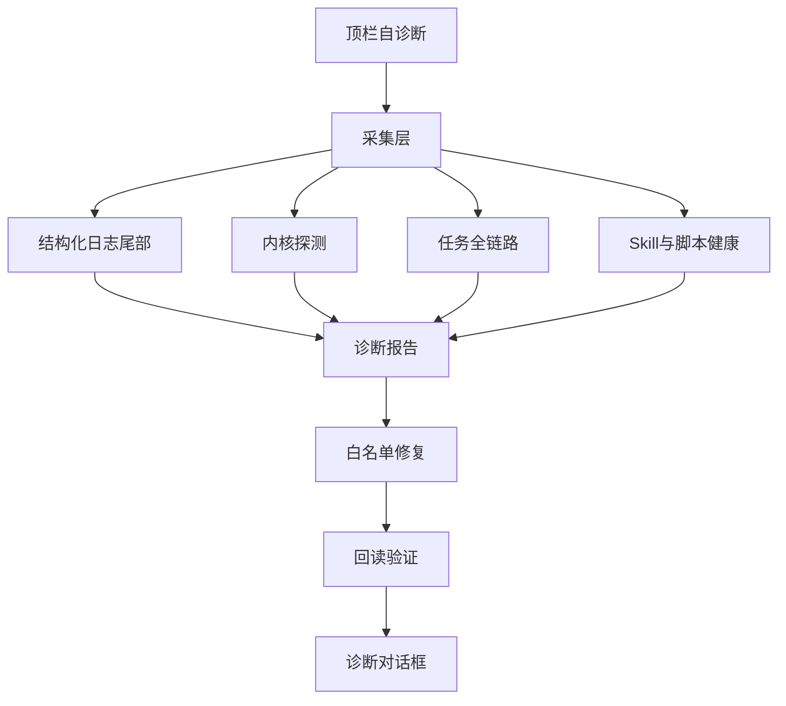

# 自诊断升级

对话顶栏「自诊断」升级为四层闭环：结构化日志 → 内核探测 → 任务全链路 → 白名单 Skill/本地记录修复。与右侧「设置与诊断」互补：自诊断偏当前对话任务；设置页偏本机环境。

## 目标

1. 关键路径写统一结构化日志；报告可附带相关日志摘录（脱敏）。
2. 检查 deepseek-harness（包内/检出/未启用）及历史 `HARNESS_CLEANUP` 证据。
3. 以最后一轮助手消息为锚，输出平台→模型→工具→Skill→落盘时间线。
4. 驱动白名单修复并回读验证；不重跑外部扣费任务，不改写 `SKILL.md` 正文。

## 非目标

- 自动重跑外部生成 / 扣费操作
- 自动改写 Skill 正文或安装任意脚本
- 日志或诊断包包含完整会话/材料正文

## 流程

## 返回契约（`chat.diagnose`）

兼容既有字段：`findings`、`repairs`、`repeated`、`activities`、`prevention`。

新增：

| 字段 | 含义 |
|---|---|
| `timeline` | `{ id, label, status, detail }[]` 全链路 |
| `logs` | 最近相关日志摘录（已脱敏） |
| `kernel` | `resolveKernelStatus` 快照 |
| `repairActions` | `{ code, label, detail, runnable, executed?, verified? }[]` |

`status`：`ok | warn | error | skipped | fixed | info`。

## 白名单修复（一期）

| code | 行为 | 验证 |
|---|---|---|
| `EMPTY_REPLY` / 卡死步骤 | 自动本地记录修复（聊天摘要不含逐步清单） | DB 回读 |
| `SKILL_INSTALL_MISSING` | 对绑定 skill 触发 `market.install` 重装 | `readInstalledSkill` |
| `SKILL_BINDING_STALE` | 可选手动解除绑定 | binding 表为空 |
| `SKILL_OUTPUT_FAILED` | 仅报告，不重跑 | — |
| `BRIDGE_UNAVAILABLE` | UI 侧检测，提示重启 | `cpclaw.workspace` |
| `SERVICE_CATALOG_REJECTED` | 刷新平台能力并按其白名单重裁下发目录 | 能力缓存与裁剪结果 |
| `REPLY_INCOMPLETE` | 无执行回执时按原请求重试 | 重新诊断后的状态 |
| 即梦 OAuth | 保持既有授权路径 | 既有契约 |

手动动作经 `chat.diagnoseRepair` 执行，互斥同 `SLOT_BUSY`。

## 服务目录兼容性

平台对 `serviceTools` 做类型白名单校验，平台版本落后时整轮对话会被 400 拒绝（表现为无回复）。契约以 `packages/contracts/src/service-catalog.ts` 为单一真源：

- 平台 `GET /health` 自报 `serviceTypes`；
- 桌面端发送前按平台能力裁剪目录（`fitServiceCatalog`），剔除不兼容类型并修正 `activeId`；
- 平台未声明能力时按最保守口径（`CLI/MCP`）下发；
- 平台拒绝时错误带 `reason`，自诊断识别为 `SERVICE_CATALOG_REJECTED`。

## 日志

- `LogService` 增加 `cpclaw-desktop-worker`、`cpclaw-desktop-ui`
- 落盘：`CPCLAW_DATA_DIR/logs/`（轮转 1MB）
- 字段含 `chatId` / `runId` / `requestId`（有则写）；禁止密钥与正文

## DoD（一期）

- [x] 本设计文档
- [x] 统一 worker/UI 日志 + 报告附带摘录
- [x] 内核检查并入报告
- [x] 最后一轮全链路时间线
- [x] Skill 安装缺失重装 + 验证；UI 展示修复项
- [x] 测试与 `guide/故障恢复.md` 同步

## 二期

选定历史消息诊断、诊断包联动、更多 CLI/connector 白名单修复。

## 已实现的图片任务恢复（2026-10-28）

新增 `media-task-state.mjs` 按本轮持久化回执还原提交与资源身份，区分 `pending / generated / delivered / failed / unknown`；`service-images.mjs` 负责当前账号/聊天内文件校验。诊断返回 `task`（图片及原提交状态）与 `summary`（检查完成、修复状态、待处理数量）；时间线增加图片生成与交付段。

`chat.diagnose` 自动恢复已在本机的成功图片，记录 `recover_image` 回执、准备预览并补充原消息，保留原始执行终态。对可续接的原任务自动执行 `discover → operation status → resource get → resource download`，不进入模型生成循环、不调用 `node run`；`chat.diagnoseRepair(MEDIA_RESUME)` 保留再次查询入口。恢复回执持久化，重启后沿用原提交；暂未终结的任务允许再次查询，不自动无界轮询。

Electron 主进程使用原生解码生成最长边2048像素的缩略预览，保留原图与打开入口。下载与预览状态独立；校验失败不报交付成功。预览准备失败时仍保留下载的成功路径、大小及哈希。所有文件入口绑定当前账号/对话，并校验真实路径。

`verified` 仅在本次至少执行一项修复且全部验证通过时为1；`repairState` 区分 `none / verified / failed`。图片交付通过只证明本机文件与预览可用，不自动把其他未完成目标标为完成。

仍未覆盖：任意历史消息选择、自动重新付费生成、无已保存身份的任务推断、服务端网关自身修复，以及视频/音频交付恢复。

## 系统维护权限与经验

自诊断作为系统维护入口，使用宿主颁发的 `system-diagnostic` 权限，优先于普通对话的权限模式。已注册维护动作直接执行；账号/对话隔离及系统实际权限继续生效，普通模型参数不能颁发维护权限。完成的诊断与修复存入本机台账；已验证策略和仅观察到的问题分别沉淀，并在同类诊断中加载展示。决策与边界见 `docs/decisions/ADR-004-系统自诊断与经验闭环.md`。
