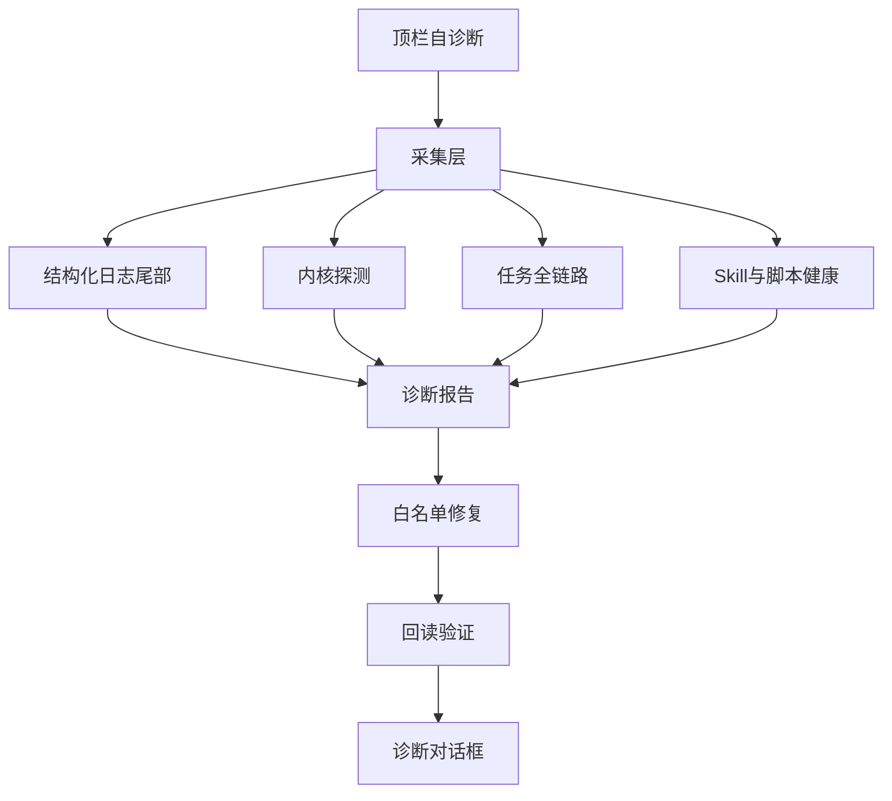

# 自诊断升级

对话顶栏「自诊断」升级为四层闭环：结构化日志 → 内核探测 → 任务全链路 → 白名单 Skill/本地记录修复。与右侧「设置与诊断」互补：自诊断偏当前对话任务；设置页偏本机环境。

## 目标

1. 关键路径写统一结构化日志；报告可附带相关日志摘录（脱敏）。
2. 检查 deepseek-harness（包内/检出/未启用）及历史 `HARNESS_CLEANUP` 证据。
3. 以最后一轮助手消息为锚，输出平台→模型→工具→Skill→落盘时间线。
4. 驱动白名单修复并回读验证；不重跑外部扣费任务，不改写 `SKILL.md` 正文。

## 非目标

- 自动重跑外部生成 / 扣费操作
- 自动改写 Skill 正文或安装任意脚本
- 日志或诊断包包含完整会话/材料正文

## 流程

## 返回契约（`chat.diagnose`）

兼容既有字段：`findings`、`repairs`、`repeated`、`activities`、`prevention`。

新增：

| 字段 | 含义 |
|---|---|
| `timeline` | `{ id, label, status, detail }[]` 全链路 |
| `logs` | 最近相关日志摘录（已脱敏） |
| `kernel` | `resolveKernelStatus` 快照 |
| `repairActions` | `{ code, label, detail, runnable, executed?, verified? }[]` |

`status`：`ok | warn | error | skipped | fixed | info`。

## 白名单修复（一期）

| code | 行为 | 验证 |
|---|---|---|
| `EMPTY_REPLY` / 卡死步骤 | 自动本地记录修复 | DB 回读 |
| `SKILL_INSTALL_MISSING` | 对绑定 skill 触发 `market.install` 重装 | `readInstalledSkill` |
| `SKILL_BINDING_STALE` | 可选手动解除绑定 | binding 表为空 |
| `SKILL_OUTPUT_FAILED` | 仅报告，不重跑 | — |
| `BRIDGE_UNAVAILABLE` | UI 侧检测，提示重启 | `cpclaw.workspace` |
| 即梦 OAuth | 保持既有授权路径 | 既有契约 |

手动动作经 `chat.diagnoseRepair` 执行，互斥同 `SLOT_BUSY`。

## 日志

- `LogService` 增加 `cpclaw-desktop-worker`、`cpclaw-desktop-ui`
- 落盘：`CPCLAW_DATA_DIR/logs/`（轮转 1MB）
- 字段含 `chatId` / `runId` / `requestId`（有则写）；禁止密钥与正文

## DoD（一期）

- [x] 本设计文档
- [x] 统一 worker/UI 日志 + 报告附带摘录
- [x] 内核检查并入报告
- [x] 最后一轮全链路时间线
- [x] Skill 安装缺失重装 + 验证；UI 展示修复项
- [x] 测试与 `guide/故障恢复.md` 同步

## 二期

选定历史消息诊断、诊断包联动、更多 CLI/connector 白名单修复。
