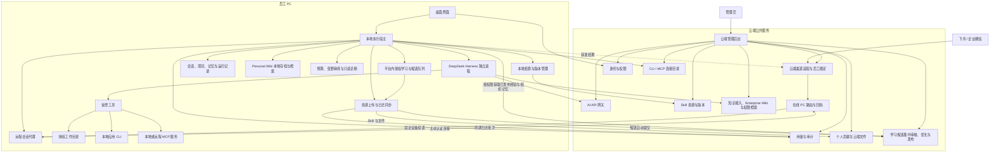

# 企业级智能体平台首期建设方案

> 日期：2026-10-21  
> 状态：建设边界已确认；具体技术栈与接口待验证  
> 关联材料：[企业级智能体平台技术方案](企业级智能体平台技术方案.md)

本文是范围与阶段摘要，技术契约以主技术方案 V1.8 为准；PC 页面与交互见 [WorkBuddy 参考设计](PC端功能与交互设计_WorkBuddy参考.md)。技术栈、具体平台版本及未核验内核能力均不视为已确认。

## 1. 已确认的建设边界

建设“云端公共资源管理 + 员工本地 PC 智能体应用”的企业级平台。

| 项目 | 首期范围 | 后续方向 |
|---|---|---|
| 客户端 | macOS | Windows |
| 身份与权限 | 与平台一起建设 | 可对接企业现有身份源 |
| AI API | 建设统一网关及管理能力 | 增加模型提供商与路由策略 |
| 公共资源 | 公共 Skill、混合办公文档知识库与 Enterprise Wiki | 按场景增加资源类型 |
| 个人知识 | Personal Wiki 本地 Markdown 存档、维护与查询引用 | 通过审核候选贡献组织，整库同步不作为默认 |
| 执行内核 | 本地封装 DeepSeek Harness | 按验证结果升级内核版本 |
| 执行位置 | 员工 PC | 可增加云端执行器 |
| PC 关闭后 | 不继续执行任务 | 后续可增加后台托管任务 |
| 办公软件 | 飞书、企业微信对话入口，由在线 PC 执行 | 附件、群聊、卡片及更多渠道 |
| 个人资源上传 | PC Skill 上传云端资源池、生成文件上传云端 | 按需扩展协作与资源流转 |
| PC 日志 | 按配置周期自动同步云端，断网可补传 | 按运营需求扩展诊断分析 |
| CLI / MCP | CLI 驱动其他应用、MCP 调用第三方服务 | 增加获准应用和服务 |
| 项目与记忆 | 本地项目、显式或授权自动沉淀的个人/项目记忆、审核发布的组织记忆 | 原始项目共享另行设计，个人偏好不自动推广 |
| 任务治理 | 验收条件、预算停止、变更审阅与受控恢复 | 按真实业务扩展检查和补偿能力 |
| 经验与质量 | 授权从平台内工作自动沉淀经验/记忆/Skill，提交云端审核优化并下发；诊断与回归 | 扩展到其他应用采集及浏览器自动化需另定范围 |

本文据此收敛首期范围。原技术方案中的云端执行器、租约调度和跨端协同作为后续设计参考，不纳入首期交付。

## 2. 产品组成

### 2.1 云端管理后台

管理员管理账号、组织、角色、模型、公共 Skill、知识库与使用记录。新增个人 Skill 贡献的检查与审核、云端文件权限、PC 日志查询与同步策略管理。上传文件默认私有、个人 Skill 上传后再审核发布是建议默认规则，具体角色和共享范围由企业配置。

经验、记忆及 Skill 候选自动进入资源池受限待审区，云端集中检查、去重、优化、验证并对固定版本终审，按部门/项目/角色发布；Skill 沿用个人贡献发布链，经验卡进入获准知识检索，组织记忆按范围加载。业务回归报告作为发布证据管理，不增加云端 Agent 运行时或独立评测集群。

云端首期承担公共服务和资源治理，不运行员工的 Agent 推理循环。知识文档解析、索引和已上传候选的审核优化属于有界资源管理作业，不属于员工任务后台托管。

### 2.2 员工桌面应用

员工下载安装程序，登录后使用对话、选择工作目录、下载公共 Skill、查询企业知识和调用 AI API，在本地生成或修改文件。员工也可绑定飞书、企业微信，开启远程对话后由在线 PC 处理办公软件中的指令，按授权回传结果；详见 [办公 IM 接入方案](办公IM接入与本地智能体对话方案.md)。

员工可建立本地项目，复用术语、模板、资料和任务结果，也可直接发起临时任务。个人偏好与项目约定可显式保存或按学习授权自动沉淀，来源与作用域可见；生成结果可审阅差异，对有快照和版本证据的文件操作发起受控恢复。已验收任务可手动“沉淀为 Skill”；员工也可开启有范围的自学习，使候选自动提炼并上传，发布前统一验证与审核，不逐条要求上传确认。

### 2.3 本地执行宿主

桌面界面与 Harness 之间设置执行宿主，负责运行启动、事件转发、取消、工作区授权、项目/记忆上下文修订、预算控制、变更快照、资源版本及运行记录，增加授权学习管理与有界候选队列，并复用现有检测能力提供只读诊断。Harness 负责推理与工具循环；身份、模型额度及企业知识权限由服务端最终校验。

### 2.4 双层 Wiki 与企业知识

云端保存原始混合文档、结构化资料和 Enterprise Wiki，后者由 LLM 编制、核对来源、审核后按固定 Markdown 修订发布。检索同时覆盖 Wiki 和原文，精确条款/数值回到原件；表格统计需要受控计算，不由摘要代替。原文或权限失效时阻断受影响的 Wiki 与缓存。

PC 增加 Personal Wiki，整理员工明确加入的资料及平台工作成果，本地版本化存档、按需检索、支持修正/恢复。维护授权与学习上传授权分开；组织内容为独立只读引用，个人补充不覆盖组织页面，自动贡献不扩大学习源。详细模块、数据/API、存档和 K0–K5 验收见 [企业知识库与双层 Wiki 架构设计](企业知识库与双层Wiki架构设计.md)。

## 3. 逻辑架构

图中内核到云端的箭头表示逻辑访问关系，实际可通过宿主适配器或受控工具实现。具体接口须在锁定 Harness 版本后验证，不将平台接口命名视为内核原生 API。

## 4. 云端服务职责

| 模块 | 首期职责 | 验收重点 |
|---|---|---|
| 身份与权限 | 账号、组织、角色、登录会话、续期、撤销；桌面端与管理端分别授权 | 普通员工不能访问管理接口；账号停用后不能继续访问云端资源 |
| AI API 网关 | 提供商配置、密钥保管、模型目录、准入、限额、流式转发、用量记录 | 客户端不持有供应商密钥；超额与无权限请求被拒绝 |
| Skill 管理 | 个人提交、检查、审核、发布、版本、可见范围、下载安装 | 上传不直接公开；只能下载获授权版本；失败不破坏可用版本 |
| 组织学习资源 | 自动候选受理、经验/记忆/Skill 的审核优化、验证、发布下发及反馈 | 待审受限；优化改稿重审；来源可追溯；撤销、下架与目标人群生效 |
| 云端文件 | 员工产物上传事务、文件版本及 ACL | 默认私有；可重试且不重复建资源；下载不越权 |
| 应用与服务目录 | 发布获准 CLI/MCP 定义、依赖和权限，个人凭证不下发共享 | PC 可完成安装检测及授权；实际调用和结果可追溯 |
| 知识库与 Enterprise Wiki | 混合文档解析、Wiki 编制审核/存档、原文与 Wiki 检索、来源依赖/撤权 | 未审不可见、改稿重审、定位可核对，源失效阻断派生页；数据先授权再发给模型 |
| 审计与用量 | 登录、资源变更、模型调用与用量、必要执行事件、PC 日志周期同步 | 日志脱敏、去重与补传；关联用户、设备、运行及版本；默认不上传完整业务正文 |
| 办公渠道 | 企业应用/机器人接入、员工绑定、在线 PC 路由、消息去重与原会话回复 | 飞书与企业微信分别闭环；离线明确不可执行；凭证不下发 PC |
| 客户端分发 | 安装包、版本信息、发布说明 | 可下载并安装 macOS 应用；自动更新是否纳入首期待详细设计确认 |

建议以模块化后端起步，配套事务数据库和资源对象存储。知识索引按实际检索需求选型，不预设必须引入独立向量数据库或微服务集群。

## 5. 桌面应用职责与跨平台边界

PC 端功能与交互参考 WorkBuddy 的任务工作台设计，详见 [PC 端功能与交互设计](PC端功能与交互设计_WorkBuddy参考.md)。其中三栏布局、工作模式与资源交互为待原型验证的设计建议。

| 模块 | 职责 |
|---|---|
| 登录与凭证 | 登录、退出、会话续期、安全保存本设备凭证 |
| 对话界面 | 会话列表、流式消息、工具进度、必要确认、错误与取消 |
| 工作区与项目 | 复用资料、术语、模板、任务及产物引用；项目选择不代替用户目录授权 |
| 可管理记忆 | 个人/项目/组织分域，显式或授权自动沉淀；组织版本须审核，编辑/删除与来源可查 |
| 我的 Wiki | 本地 Markdown 修订与来源，选定材料整理、检索、修正/恢复；维护与贡献分别授权，组织页面只读引用 |
| 授权自学习 | 仅平台内任务、用户修正、验收和工具回执；有范围/期限/预算，自动提交候选，支持排除/暂停/撤销 |
| 目标与预算 | 固定验收条件，跨 Run 累计消耗，预算或无进展时停止新调用 |
| 变更与恢复 | 差异/摘要、受控快照、具体版本审阅；用户后续修改冲突时不覆盖 |
| 自助诊断 | 只读检查登录、模型、工具、IM、目录及同步，给出建议；诊断包单独选择外发 |
| 执行宿主 | 管理 Harness 进程和运行生命周期，关联会话与运行标识 |
| 资源中心 | 浏览下载公共 Skill、上传个人 Skill，展示版本、审核与依赖状态 |
| 资源上传与日志同步 | 产物上传、云端位置、同步周期及状态，断网和重启后补传 |
| 本地记录 | 保存会话、运行状态、资源版本及产物引用 |
| 云端访问 | 携带员工身份调用模型网关与知识检索 |
| 应用与服务连接 | CLI 程序检测与调用、MCP 配置授权与发现调用、状态和错误展示 |
| 办公软件连接 | 远程会话开关、接收设备、获准目录、消息受理与来源标签 |

界面、业务状态、资源协议与 Harness 适配层保持跨平台。凭证存储、路径、Shell、子进程、文件权限、安装与签名通过操作系统适配层处理。

首期在 macOS 验收；Windows 适配不能仅依赖未来更换打包参数。Skill 发布信息需声明支持平台和运行依赖，客户端拒绝安装或运行不兼容资源。具体桌面框架、CPU 架构覆盖及内置脚本运行时在技术验证后确定。

## 6. 资源与数据边界

| 数据或资源 | 建议默认位置 | 使用方式 |
|---|---|---|
| 供应商 API 密钥 | 云端 | 网关代调用，不下发客户端 |
| 员工设备凭证 | 本地安全存储 | 仅用于已授权云端服务 |
| 公共 Skill 包 | 云端发布，本地安装 | 带版本、摘要值、平台及依赖声明 |
| 企业知识、Enterprise Wiki 与索引 | 云端 | 原件/Wiki 修订分别存档，索引派生；按权限在线检索与回溯，不默认整库下载 |
| Personal Wiki | 本地 | 原件引用或明确导入副本；正文版本、来源与索引分开，不默认与企业全量同步 |
| 会话、工作区与产物 | 本地，可选定产物上传云端 | 不默认全量同步；云端文件有独立版本与 ACL；IM 原文及获准回复经云端中转 |
| 项目、记忆与文件检查点 | 私人源数据默认本地 | 不随日志上传；学习授权只提交获准抽象候选，快照有容量与保留上限 |
| 自学习候选与组织资源 | 本地提炼；云端待审与发布分区 | 自动提交后待审；按固定版本、范围和兼容性下发，私人记忆不原样推广 |
| 个人 Skill 提交 | 云端资源池草稿与审核区 | 上传清单可预览，审核发布后按范围供他人下载 |
| 必要审计、用量与 PC 日志 | 云端，日志保留本地待传队列 | 日志按策略周期同步，采用字段白名单与脱敏，不上传完整业务正文 |

上述默认位置为设计建议，数据分级与保留策略仍需业务确认。本地文件进入模型请求时，相关内容会发送到网关及获准模型服务；“文件存储在本地”不等于“内容始终不出端”。

Skill 下载不能携带企业长期密钥，也不能赋予自身额外权限。已下载资源无法仅靠云端撤权自动从设备收回；客户端启动和执行前检查有效策略，离线可用范围需另行定义。服务端对每次模型与知识请求独立校验权限。

首期不承诺断网后的完整 AI 对话能力，也不将本地策略检查等同于能抵御设备所有者绕过的安全边界。

## 7. 本地任务生命周期

建议本地运行状态为：排队、执行中、等待输入、等待确认、检查结果、结果待核实、成功、失败、中断、取消中、已取消。完整状态转换、Run 重试与 Task 修订规则见主技术方案第 9 节；首期无需云端 Task 服务或调度系统。

- 模型回合结束后检查产物或操作结果，满足任务条件才显示成功。
- 多轮任务按目标与预算推进，跨重试累计工具次数、活动时长和模型费用；限额或无进展时保留成果并停止，不改写验收条件。
- 暂停与继续受同一宿主控制，先核实在途操作与剩余预算；普通聊天不默认变成无限自主循环。
- 按需加载资料与获准工具；长对话压缩保留目标、约束、预算和未知操作标识，只设一个压缩责任方。
- 取消先阻止新操作，再处理在途调用；已发生的文件修改不会自动回滚。
- 应用退出、系统睡眠、进程崩溃或关机后，不承诺继续运行。
- 重开应用后识别未结束运行并显示中断；是否支持恢复到原内核上下文由集成验证决定。
- 不自动重放中断前的写入。涉及外部系统时，结果未知的操作先核实再决定继续方式。

关闭窗口是否隐藏到托盘、退出应用时是否提示正在执行任务，属于待确认的交互规则；无论采用何种交互，都必须明确展示任务实际执行状态。

## 8. 首期端到端闭环

1. 管理员创建员工账号与权限，配置一个模型，并发布一个 macOS 可用 Skill。
2. 管理员导入知识文档，设置可访问成员，完成索引。
3. 员工安装应用、登录、获取可用模型和资源目录。
4. 员工下载 Skill，选择临时任务或本地项目，授权工作目录；需要时显式保存个人偏好或项目约定。
5. 员工提出结合企业知识和本地材料生成报告的任务，确认交付条件与预算。
6. 宿主启动 Harness，工具在授权范围读取文件，知识服务按员工权限检索。
7. 模型请求经企业网关执行，客户端展示流式输出与工具进度。
8. 在授权目录生成报告或待审阅修改，核对差异/摘要和冲突后提交，检查文件、结构与必要来源，再展示结果；受控恢复需复核当前版本。
9. 网关记录用量；本地保存会话、运行、Skill 版本与产物位置。
10. 员工可上传选定产物并查看云端可用状态；失败重试不重做生成任务。
11. 员工可手动贡献，或授权从平台内任务/修正/验收/工具回执自动提炼经验、记忆与 Skill 候选并提交受限待审区；云端集中优化验证、固定版本审核，再按范围下发给其他员工复用。
12. 客户端按配置周期同步日志，断网留队列；重新登录同一员工后补传，以云端持久化回执推进同步位置。

### 8.1 自学习授权及组织复用验收

员工授权时分别选择本地提炼、自动提交、平台内项目/来源、排除任务、历史是否纳入、候选类型、有效期和预算。默认关闭，新信号从开启后开始；不采集屏幕、键盘、全盘及其他应用。提炼需模型时经获准网关处理最小必要内容，学习成本与业务任务分开。已授权范围内自动提交，不增加逐条上传确认。

用员工 A、员工 B 及一名无权员工验证：A 的候选自动上传，未审内容他人不可见；云端修改形成新修订，事实/适用范围和 Skill 样例验证后终审；B 只获得有权且兼容的发布版本，新增能力不自动获权；无权员工不发现资源。记录 B 的验收、返工与修正，问题资源可停用和追溯来源，不以下载次数代替效果。

暂停/撤销、候选撤回与已发布资源下架分别可见，重复事件及断网补传需复核当前授权并去重。PC 关闭停止采集与提炼；云端只可继续处理此前已接收且授权仍有效的候选，不接管业务任务。日志同步、学习上行、原文件上传与向 IM 发送结果使用各自权限。

## 9. 实施步骤与验收标准

| 步骤 | 交付范围 | 验收标准 |
|---|---|---|
| 1. 技术验证 | 锁定 Harness 版本；验证宿主接口、模型网关适配、macOS 打包与进程管理 | 安装后的应用能流式对话、调用一个受控工具、取消运行；退出后无失控子进程 |
| 2. 云端基础 | 管理后台、账号权限、设备会话、模型网关 | 员工登录后只能使用获准模型；密钥不进入安装包；续期、撤销和限额生效 |
| 3. 本地工作与工具 | 项目/记忆/Personal Wiki、任务预算、审阅恢复、CLI/MCP、产物检查 | 真实 CLI/MCP、个人资料授权与 Wiki 来源/版本、预算、冲突恢复通过；中断不重放 |
| 4. 公共资源与自学习 | 知识库/Enterprise Wiki、候选上行/审核优化、组织资源下发，文件/日志 | 两员工复用、授权撤销、Wiki 来源和改稿重审通过；原文/Wiki/缓存/链接权限均有效 |
| 5. 办公入口 | 飞书与企微对话、身份/设备绑定、显式关联同一任务、消息回执 | 两渠道分别验证原会话回复、桌面与 IM 输入排序、同任务状态、重复去重、停止及离线不补执行 |
| 6. 联调交付 | 安装分发、只读诊断、必要审计、端到端场景与业务回归 | 第 8 节闭环及权限/恢复负例通过；诊断不泄密，模型/内核/Skill/连接器升级有回归证据 |

步骤中的基础权限应随对应能力交付。技术验证通过后再锁定具体框架、协议、依赖与打包方案。

## 10. 后续升级方式

- **Windows**：复用共享协议、界面和内核宿主契约，补充系统适配器、安装包和平台能力验收。
- **云端执行器**：新增平台任务服务和调度，采用同一能力版本与身份契约；云端无法直接读取员工 PC 的文件，需显式上传或改用可访问数据源。
- **后台托管**：云端执行需要独立的授权、凭证、操作台账、结果核实和状态权威来源，不能直接迁移本地会话日志后视为已支持。

首期只保留可关联的运行标识、资源版本和清晰的宿主接口，不提前建设调度集群、跨端透明迁移或通用多代理编排。

授权自学习纳入首期，来源限已确认的平台内工作信号；指定目录持续采集、跨应用活动和外部办公系统学习需另定授权。浏览器自动化仍需明确缺少 CLI/MCP 的目标业务、账号与验收页面。学习候选可自动提交，但公共发布必须审核，不自动改写企业规则或在途版本。

## 11. 详细设计仍需确认

- 首期真实业务场景与验收人，以及对应回归样例、质量与预算门槛。
- 项目初始资料、记忆保留与删除规则，文件快照限额和需要人工审阅的操作范围。
- macOS 最低版本、Apple Silicon 与 Intel 覆盖要求。
- 初始账号开通方式、组织来源，以及登录认证方式。
- 首批模型提供商、网络部署位置、数据可发送范围。
- 公共 Skill 的来源、审核负责人及脚本运行依赖。
- 知识来源、文档格式、规模、权限粒度及撤权生效要求。
- 本地会话保留、PC 日志采集级别、同步周期、队列容量与保留规则。
- 个人 Skill 的本地运行准入、资源池审核角色、文件空间容量与共享规则。
- 自学习的项目排除、学习预算、授权/证据保留期限、初审与终审角色、下发人群及更新策略。
- 首批 CLI 应用及命令接口、MCP 服务地址、版本、认证方式和测试账号。

CLI 与 MCP 均纳入首期，具体工具按连接器逐项验收；不是对所有软件的 GUI 控制承诺。Skill、桌面对话与 IM 入口复用相同权限，外部写入超时先核实，不因连接成功就视为任务成功。

这些问题不改变已确认的云端管理、本地执行和 macOS 首发方向，但应在对应实现开始前收敛。

日志定时同步只在客户端运行时执行，关机时暂停；重开补传日志不等于恢复业务任务。生成文件上传不默认发布到 IM、加入知识索引或同步整个工作目录。

办公渠道属于交互与消息中转能力，不改变本地任务状态归属，也不增加云端后台托管。群聊、附件及聊天内确认按实际平台权限另行验证。
